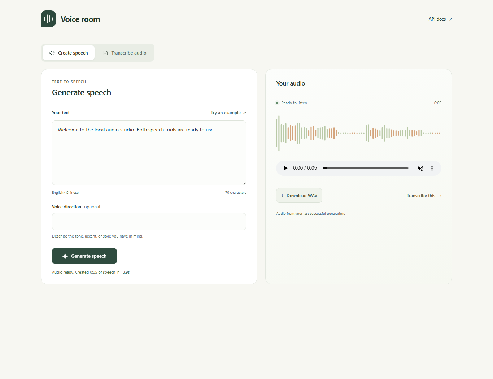
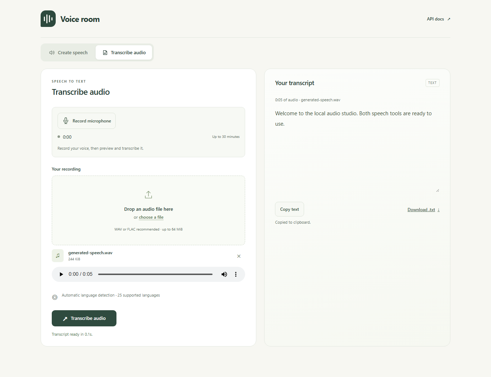
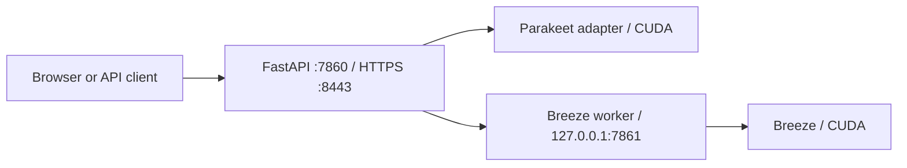

# Local Speech API

A simple prototype of self-hosted speech-to-text and text-to-speech on one consumer GPU, behind a single FastAPI service with a browser app. Audio and text never leave the machine.

| Create speech | Transcribe audio |
| --- | --- |
|  |  |

## What it does

- **Speech in:** [NVIDIA Parakeet TDT 0.6B v3](https://huggingface.co/nvidia/parakeet-tdt-0.6b-v3) transcribes 25 European languages, Danish included, with automatic language detection. WAV or FLAC, up to 30 minutes.
- **Speech out:** [Breeze TTS 2](https://huggingface.co/BreezeBlue/Breeze-TTS-2) generates English and Chinese speech from text, with an optional voice description or voice cloning from a reference clip. Audio streams back as it is generated.
- **Browser app:** record from a phone's microphone over trusted HTTPS on the local network, transcribe uploads, generate speech, and send generated speech straight into transcription. Served by the same process, with no build step or external assets.
- **API:** OpenAI-style routes, `POST /v1/audio/transcriptions` and `POST /v1/audio/speech`, with interactive docs at `/docs`.

## How it is arranged



- **Replaceable models.** Speech generation and transcription each sit behind a small provider contract. Routes and the website never import a model; adapters own loading, inference settings, native formats, language metadata and readiness. `__main__.py` builds the providers and injects them. Swapping a model means writing one adapter. See the [speech](docs/api/speech/README.md) and [transcription](docs/api/transcription/README.md) contracts.
- **Two environments, one service.** Breeze needs Transformers 4.57 and Parakeet needs 5.20, so each runs in its own environment. The public API proxies speech requests to a private Breeze worker bound to loopback.
- **Validated at the edge.** Pydantic validates public forms and each adapter's configuration before inference ([rules](docs/api/pydantic/README.md)).
- **Bounded and recoverable.** Each model runs one inference at a time and answers a second request with HTTP 409 while health stays responsive. Uploads are limited in bytes, sample rate, duration and decoded samples. A client that disconnects mid-stream releases the inference slot.
- **Owned processes.** Start and stop scripts record process identity, wait for both models to load, roll back a half-started service and check that ports are released.

## Quick start

Requires Windows, an NVIDIA GPU with about 16 GB of memory, Git and [uv](https://docs.astral.sh/uv/). The installer downloads Python into the project and pins libraries, model revisions and the Breeze source. Allow about 30 GB of disk.

```powershell
.\Install-SpeechApi.ps1
.\Start-SpeechApi.ps1
```

Open http://localhost:7860 for the browser app or http://localhost:7860/docs for the API. Models load offline after installation. `.\Stop-SpeechApi.ps1` stops both processes.

## Call the API

```powershell
curl.exe http://localhost:7860/v1/audio/transcriptions -F "file=@recording.wav"
```

```json
{"text":"Hello from the local network.","model":"nvidia/parakeet-tdt-0.6b-v3","duration":2.4}
```

```powershell
curl.exe http://localhost:7860/v1/audio/speech -F "text=Hello from the local network." -F "instruction=A warm, clear English narrator." --output speech.pcm
```

Speech returns streaming raw mono PCM, signed 16-bit little-endian, with the sample rate in `X-Sample-Rate` (24 kHz for Breeze). [`examples/speak.py`](examples/speak.py) and [`examples/transcribe.py`](examples/transcribe.py) use only Python's standard library, write playable WAV files and accept `--url` for another host.

## Use it from other devices

Other devices on the network reach the service at `http://<server-ip>:7860`. Browsers allow microphone recording only on localhost or trusted HTTPS, so for recording from a phone:

```powershell
.\scripts\Setup-Https.ps1 -Address '<server-ip>'
.\Start-SpeechApi.ps1
```

Each device then installs the public certificate once from `http://<server-ip>:7860/assets/recording/setup.html` and uses `https://<server-ip>:8443/`. Private keys stay in `runtime/tls`. `scripts\Enable-Lan.ps1` (administrator) adds a firewall rule limited to the local subnet. See [HTTPS and microphone access](docs/api/https/README.md).

The API has no authentication. Run it on a network you trust.

## Tests

```powershell
& .\runtime\parakeet\.venv\Scripts\python.exe -m pytest -q
.\tests\Test-StartupRollback.ps1
```

Unit tests replace the models with fakes, so they run without loading weights. The scripts in `verify` (`Verify-SpeechApi.py`, `Verify-Breeze.py`, `Verify-Website.py` and `Verify-Microphone.py`) check the running service with the real models, the last two in headless Chromium. See [verification](docs/verification.md) for measured results and limits, and [website](docs/website.md) for the browser checks.

## Layout

| Path | Purpose |
| --- | --- |
| `src/speech_api` | FastAPI composition, audio decoding, HTTP serving and the Breeze proxy |
| `src/speech_api/speech` | Speech contract, routes and Breeze adapter |
| `src/speech_api/transcription` | Transcription contract, routes and Parakeet adapter |
| `web` | Browser app: forms, API calls, playback, waveform and microphone recording |
| `tests` | Unit tests and the startup rollback test |
| `examples` | Standard-library clients |
| `scripts` | Model installers, HTTPS setup, firewall rule and process helpers |
| `verify` | Checks against the running service with the real models |
| `requirements` | Pinned Python dependencies for the two environments |
| `runtime` | Installed Python, environments, models, caches, logs and certificates (not in Git) |

## Licences

The code in this repository is under the [MIT licence](LICENSE). Third-party model weights are downloaded at install time and are not part of this repository. Breeze TTS 2 weights and their outputs are under a [research and non-commercial licence](https://huggingface.co/BreezeBlue/Breeze-TTS-2/blob/main/LICENSE); its source is Apache 2.0. Parakeet TDT 0.6B v3 is [CC BY 4.0](https://huggingface.co/nvidia/parakeet-tdt-0.6b-v3).
